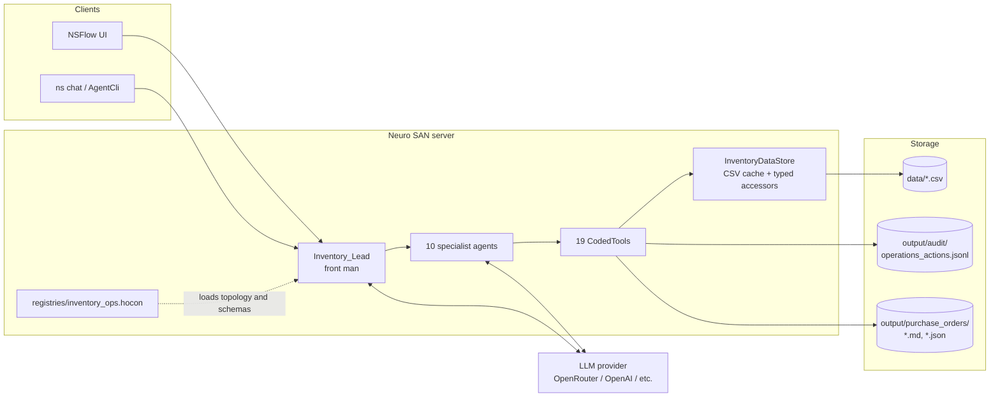
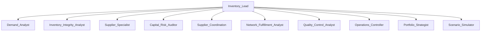
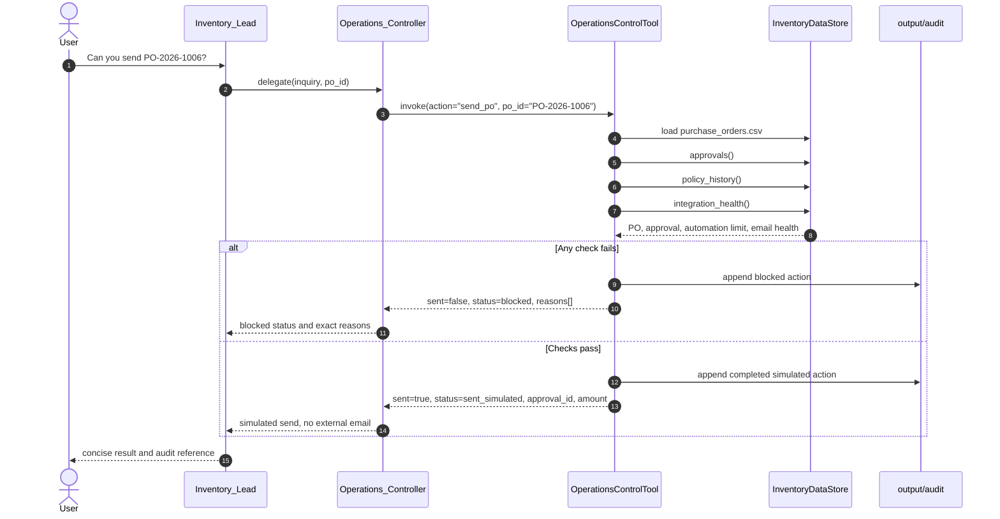
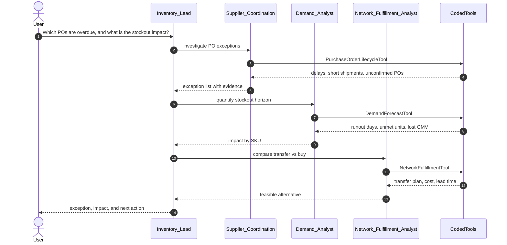
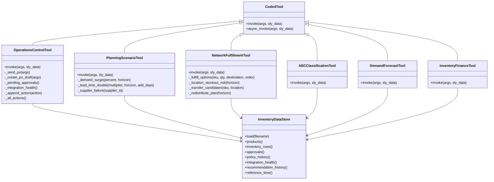
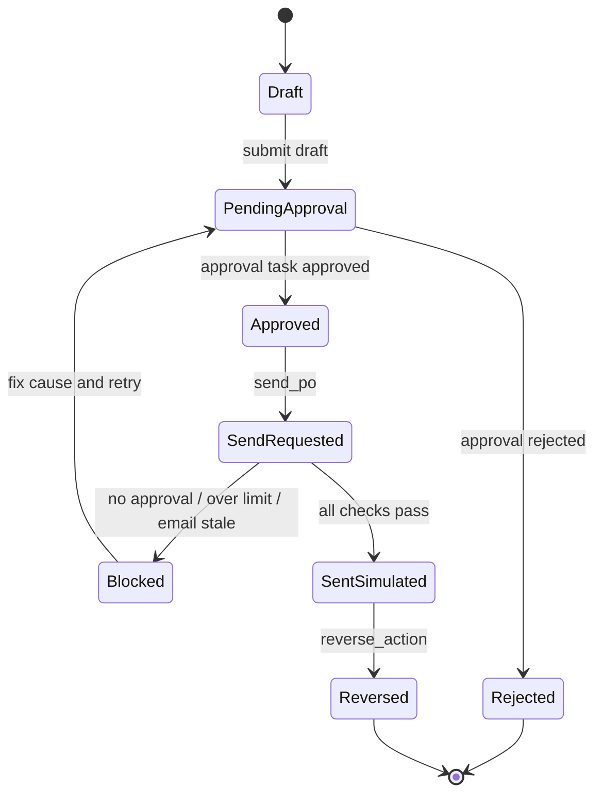
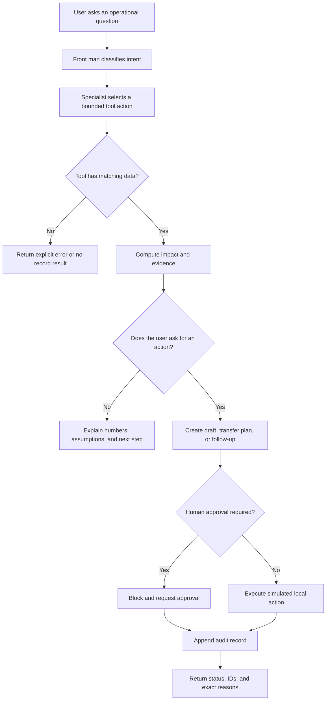
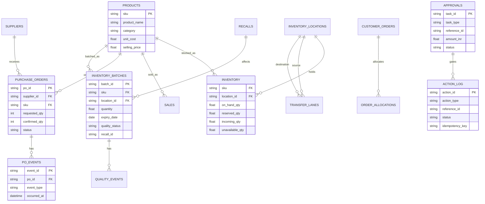
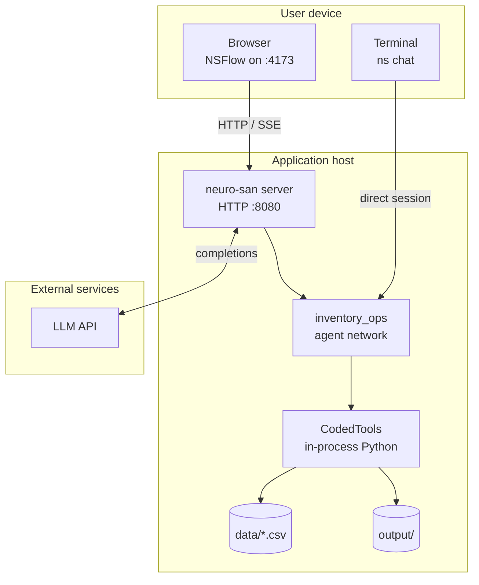

# Inventory Operations Agent — Technical Architecture (v2)

This is the technical companion to `architecture.md`. It is written for engineers who need to
modify, extend, test, or integrate the network. All diagrams are Mermaid and render on GitHub.

## Executive summary

The Inventory Operations Agent is a workflow-completion system, not a dashboard or a generic chat
assistant. A seller asks an operational question; the front man routes it to a domain specialist;
the specialist calls a deterministic tool; the tool returns grounded numbers; and the network
turns that result into an explained recommendation or an approval-gated action.

The architecture is deliberately split into three layers:

1. **Agent layer** — 11 LLM agents for intent, routing, explanation, and synthesis.
2. **Deterministic layer** — 19 CodedTools for arithmetic, policy checks, and local state changes.
3. **Data layer** — 38 synthetic CSV snapshots accessed through one shared `InventoryDataStore`.

This separation is the core design decision. The LLM is good at interpreting an ambiguous question
and explaining a trade-off. It is not trusted to compute stock positions, approve spend, or invent
supplier facts. Every number shown to a user comes from a tool.

## Design decisions and trade-offs

| Decision | Why | Trade-off |
|---|---|---|
| Front man plus specialist agents | Focused context and clear ownership | More LLM hops than a single prompt |
| Deterministic CodedTools | Reproducible numbers and testability | Tools must be extended for new calculations |
| Shared `InventoryDataStore` | One schema, one cache, consistent parsing | CSV snapshots are not production-transactional |
| HOCON registry | Declarative topology, routing, and schemas | Runtime changes require a reload |
| Approval-gated PO send | Prevents unauthorized spend or email | A human must approve before sending |
| Idempotency keys and audit log | Safe retries and accountability | Local JSONL is not a distributed ledger |
| Simulated integrations | Safe demo with no external side effects | Not a live Shopify/ERP/email adapter |
| Synthetic data | Reproducible demos and tests | Real seller data will need schema mapping |

## 1. Scope and constraints

- **Runtime:** Cognizant Neuro SAN Studio, one HOCON network (`registries/inventory_ops.hocon`).
- **Topology:** 11 agents, 19 deterministic CodedTools.
- **Execution bounds:** `max_steps: 75`, `max_execution_seconds: 900`.
- **Data:** synthetic CSV snapshots in `data/`, read through `InventoryDataStore`.
- **Side effects:** local files only. Marketplace, email, ERP, payments, and WMS are simulated.
- **LLM role:** intent routing, tool selection, explanation. No arithmetic or state transition is
  delegated to the LLM.
- **Human gate:** every PO send requires an approved send task, an amount within the automation
  limit, and healthy email integration.

## 2. Component view



### Runtime boundaries

| Boundary | Responsibility | Not responsible for |
|---|---|---|
| NSFlow / CLI | Transport and rendering | Business logic |
| Front man | Intent routing and synthesis | Calling coded tools directly |
| Specialist agent | Tool selection and explanation | Recomputing tool output |
| CodedTool | Deterministic computation and local state changes | LLM reasoning |
| InventoryDataStore | CSV loading, caching, normalization | Transactional locking |
| Output files | Audit and draft artifacts | Source-of-truth inventory |

## 3. Agent topology



### Routing contract

The front man routes by intent, not by keyword alone:

| Intent | Owner |
|---|---|
| Forecast, velocity, stockout horizon, RTO demand | `Demand_Analyst` |
| Reconciliation, stale source, negative stock, trust | `Inventory_Integrity_Analyst` |
| MOQ, case pack, lead-time variance, vendor reliability | `Supplier_Specialist` |
| Budget, margin, carrying cost, service level | `Capital_Risk_Auditor` |
| PO acknowledgment, delay, short shipment, follow-up | `Supplier_Coordination` |
| Transfer vs buy, location risk, sellability, allocation | `Network_Fulfillment_Analyst` |
| Damage, expiry, recall, returns, cycle count | `Quality_Control_Analyst` |
| Daily queue, approvals, integrations, PO draft/send, audit | `Operations_Controller` |
| ABC/XYZ segmentation | `Portfolio_Strategist` |
| Demand, lead-time, budget, supplier-failure scenarios | `Scenario_Simulator` |

### Agentic loop

```text
1. User asks a question in NSFlow or the CLI.
2. Inventory_Lead classifies the operational intent.
3. The matching specialist receives the inquiry and optional identifiers.
4. The specialist selects one bounded tool action.
5. The tool reads the data store and returns structured evidence.
6. The specialist explains the result without recomputing it.
7. The front man synthesizes a concise answer and next step.
8. If the user asked for an action, the tool creates a draft, plan, or approval request.
9. Every state-changing action is appended to the audit log.
```

The loop is intentionally narrow: one specialist hop per question wherever possible, and no raw
CSV rows in prompts.

### Example traces

| User question | Specialist | Tool |
|---|---|---|
| Which POs are overdue for confirmation? | `Supplier_Coordination` | `PurchaseOrderLifecycleTool` |
| Which SKUs run out in 14 days? | `Demand_Analyst` | `DemandForecastTool` |
| Can I fulfil ORD-LOC-9001 from another warehouse? | `Network_Fulfillment_Analyst` | `NetworkFulfillmentTool` |
| How much cash is tied up in inventory? | `Capital_Risk_Auditor` | `InventoryFinanceTool` |
| Which products need a physical count? | `Quality_Control_Analyst` | `InventoryQualityTool` |
| Create and send a PO draft | `Operations_Controller` | `OperationsControlTool` |

## 4. Sequence: approval-gated PO send



### Send invariants

- The tool resolves either a seeded PO from `purchase_orders.csv` or a completed `po_draft` action
  from the audit log.
- Approval lookup is by `reference_id == po_id` and `task_type == purchase_order_send`.
- The amount is `requested_qty * unit_cost`, or `total_amount` for a draft.
- `marketplace_api` being down does **not** block email send. Only `email` health does.
- A repeated send returns the prior completed action (`idempotent_replay: true`).

## 5. Sequence: exception investigation



## 6. Class model



### Tool implementation rules

1. One class per file, named after the class.
2. `invoke` is synchronous and deterministic; `async_invoke` wraps blocking I/O with
   `asyncio.to_thread`.
3. Data access goes through `InventoryDataStore`; tools do not read CSVs directly.
4. Unknown actions return an explicit error, not a silent fallback.
5. Percentages accept either `0.8` or `80` where a fraction is expected.
6. Tool outputs are structured dictionaries with stable keys; agents must not recompute them.

## 7. State model: purchase order and send



> `SentSimulated` is a local audit state. It does not mean an external email was delivered.

## 8. Activity: how an exception becomes an action



## 9. Data model



### Data groups

| Group | Files |
|---|---|
| Baseline | `products`, `inventory`, `channel_inventory`, `inventory_locations`, `inventory_ledger`, `sync_status`, `sales`, `calendar`, `promotions`, `returns`, `suppliers`, `supplier_alternatives`, `supplier_contacts`, `purchase_orders`, `po_events`, `shipments`, `receipts`, `replenishment_policy`, `cost_policy`, `followup_policy` |
| Multi-location | `location_demand`, `fulfillment_capacity`, `transfer_lanes`, `transfers`, `customer_orders`, `order_allocations`, `sellability_rules` |
| Quality | `inventory_batches`, `quality_events`, `recalls`, `inventory_counts` |
| Finance | `freight_costs`, `policy_history` |
| Operations | `inventory_snapshots`, `approvals`, `recommendation_history`, `action_log`, `integration_health` |

## 10. Deployment view



## 11. Key code paths

| Path | Purpose |
|---|---|
| `registries/inventory_ops.hocon` | Agent topology, routing, tool schemas, guardrails |
| `coded_tools/inventory_ops/data_store.py` | CSV cache and typed accessors |
| `coded_tools/inventory_ops/operations_control_tool.py` | Queue, approvals, drafts, sends, reversals, audit |
| `coded_tools/inventory_ops/purchase_order_draft_tool.py` | Markdown/JSON PO artifacts |
| `coded_tools/inventory_ops/network_fulfillment_tool.py` | Transfer, sellability, allocation, closure |
| `coded_tools/inventory_ops/planning_scenario_tool.py` | Demand, lead-time, budget, supplier-failure scenarios |
| `coded_tools/inventory_ops/abc_classification_tool.py` | ABC/XYZ segmentation |
| `scripts/generate_extended_inventory_data.py` | Deterministic additive data generation |
| `tests/` | Unit and data-contract tests |

## 11.1 Security, safety, and observability

**Secrets and data**

- API keys come from environment variables or `.env`; no key is stored in HOCON.
- All demo data is synthetic and contains no PII.
- `data/` is treated as immutable source data.
- Runtime artifacts under `output/` are gitignored.

**Action safety**

- The LLM cannot write to source CSVs.
- The LLM cannot send a supplier message without an approved send task.
- `send_po` checks approval, automation limit, and email health before writing a completed action.
- Reversals are compensating actions; the original audit record is never deleted.
- Positive physical stock is not treated as sellable when batch, expiry, recall, reservation, or
  channel rules fail.

**Observability**

| Signal | Location |
|---|---|
| Agent thinking and routing | NSFlow trace / thinking files |
| Tool calls and results | Agent trace |
| State-changing actions | `output/audit/operations_actions.jsonl` |
| PO artifacts | `output/purchase_orders/*.md`, `*.json` |
| Data anomalies | `data/` fixtures and data-contract tests |

**Production gaps**

- No authentication or tenant isolation.
- No row-level locks or ACID transactions.
- No live integration retry, rate-limit, or webhook handling.
- No metrics/tracing backend.

## 12. Failure and recovery behavior

| Failure | Current behavior | Production next step |
|---|---|---|
| Missing CSV | Tool logs and returns an empty/error result | Schema validation at startup |
| Unknown action | Explicit error | Same |
| PO not found | Explicit `not found` error | Same |
| No approved send task | Block with exact reason | Same |
| Amount over limit | Block with exact reason | Configurable per store |
| Email integration stale | Block with exact reason | Retry with backoff |
| Marketplace down | Blocks marketplace actions, not email send | Circuit breaker |
| Duplicate draft/send | Idempotent replay from audit | Same, backed by a database |
| Concurrent readers | In-memory cache per process | Row locks / distributed lock |
| LLM summary drift | Prompt constraints and tool-first design | Schema-validated response rendering |

## 13. Test strategy

- **Unit tests:** each tool's actions, edge cases, and error paths.
- **Data-contract tests:** required columns, anomaly fixtures, reference-time coverage.
- **HOCON validation:** `python -m neuro_san_studio validate registries/inventory_ops.hocon`.
- **Live smoke tests:** location, quality, finance, scenario, operations, PO draft/send.
- **Current suite:** 84 inventory domain tests across 11 modules (86 tests across 12 modules including dependency hygiene).

```bash
source venv/bin/activate
python -m neuro_san_studio validate registries/inventory_ops.hocon
PYTHONPATH=. python -m unittest tests.test_advanced_inventory_ops tests.test_inventory_reconciliation_tool \
  tests.test_demand_forecast_tool tests.test_replenishment_engine_tool \
  tests.test_supplier_coordination_tools tests.test_network_fulfillment_tool \
  tests.test_inventory_quality_tool tests.test_inventory_finance_tool \
  tests.test_planning_scenario_tool tests.test_operations_control_tool \
  tests.test_extended_data_contract
# Or run all 86 unit and contract tests:
PYTHONPATH=. python -m unittest tests/test_*.py
```

## 14. Extension points

1. **New tool:** add one class under `coded_tools/inventory_ops/`, register it under the network's
   `tools`, and add a specialist route only if the tool needs a new domain.
2. **New agent:** add an LLM agent block with `instructions`, a `function.parameters` schema, and a
   narrow `tools` list; add it to the front man's `tools`.
3. **New data source:** extend `InventoryDataStore` with a loader and reference-time handling, then
   add a data-contract test.
4. **Live integration:** replace the simulated adapter behind the tool interface; keep the approval
   gate and audit contract unchanged.
5. **Database migration:** keep the tool API stable, replace the store's CSV implementation with
   repository methods, and add transactional locking.

## 15. Known boundaries

This v2 document is still an MVP architecture. It does not implement joint multi-echelon
optimization, simultaneous budget/CBM/weight/pallet constraints, ACID transactions, live API
execution, physical return grading, GST/FX/early-payment modeling, or sub-200 ms checkout
allocation. The detailed audit is in `docs/known_limitations.md`.
